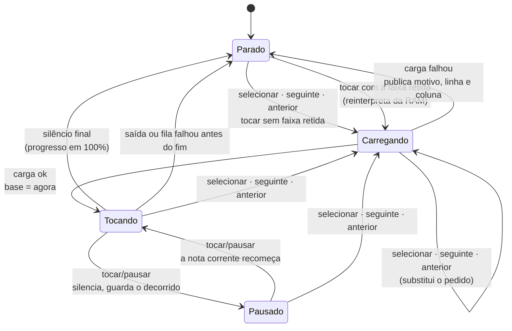
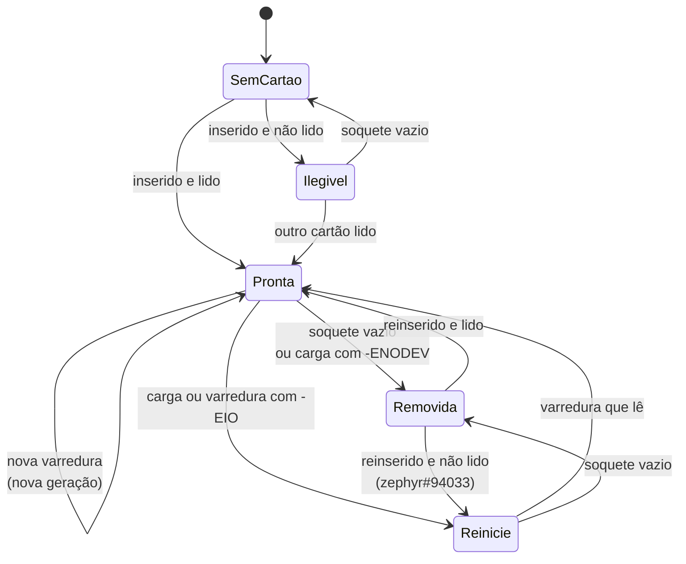
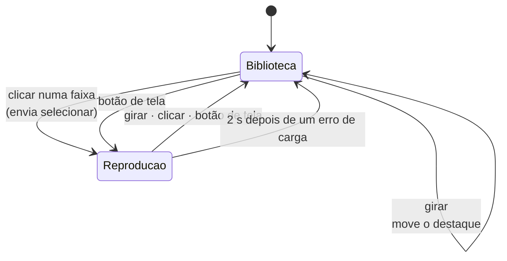

# Máquinas de estado

Três máquinas organizam o comportamento do Vitrolinha. Cada uma tem um dono e
um único escritor, e as outras só a leem:

| Máquina | Dono | Quem lê | Onde |
|---|---|---|---|
| Reprodução | thread `player` e o callback do timer | `ui`, pelo instantâneo | `src/player.c` |
| Biblioteca | monitor do cartão e `loader` | `player` (sem trava), `ui` | `src/library.c` |
| Navegação | `ui`, no laço do LVGL | ninguém | `src/display.c` |

Os comandos entram na reprodução por uma fila (`cmd.h`), vindos dos botões e
do clique na lista; a reprodução publica o resultado no instantâneo
(`snapshot.h`), e a tela o lê sem bloquear. Nenhuma das três espera outra: é o
que mantém a regra de que nada atrasa a próxima nota.

## 1. Reprodução

O estado publicado é um de três — **parado**, **tocando**, **pausado** — e o
`player` guarda ao lado um sinal interno, **carregando**, que vale enquanto o
`loader` lê o arquivo e enche a fila de eventos. Durante a carga o estado
publicado é parado, já com a faixa nova: a tela mostra o nome antes do som.

| De | Evento | Para | Efeito |
|---|---|---|---|
| qualquer | selecionar, com a biblioteca pronta | carregando | silencia; zera o erro anterior; pede a faixa ao `loader` |
| qualquer | seguinte / anterior | carregando | a faixa é a vizinha tocável (`library_neighbor`), pulando as marcadas com `!` e dando a volta nas pontas; sem vizinho — cartão fora ou nenhuma faixa válida — o comando não faz nada |
| carregando | resultado pronto e sem erro | tocando | `base_us = agora`; aplica o primeiro evento e arma o timer |
| carregando | resultado com erro | parado | publica `load_error`, `error_line` e `error_column`; a tela mostra o motivo |
| carregando | tocar/pausar | carregando | ignorado: não há o que pausar |
| tocando | tocar/pausar | pausado | silencia; `base_us` passa a guardar o decorrido |
| pausado | tocar/pausar | tocando | `base_us = agora − início da nota corrente`: a nota recomeça inteira, e um único ajuste conserta o agendamento e o tempo exibido |
| tocando | callback entrega o silêncio final | parado | `base_us = total_us`: a barra fica em 100% |
| tocando | saída recusou um tom, ou a fila esvaziou antes do fim | parado | no ponto em que parou; não é erro do arquivo |
| parado | tocar/pausar, com a faixa ainda retida no `loader` | carregando | reinterpreta do buffer em RAM, sem tocar no cartão — funciona com o cartão fora |
| parado | tocar/pausar, sem faixa retida e com a biblioteca pronta | carregando | a faixa do instantâneo, ou a primeira tocável |
| qualquer | parar (`CMD_STOP`) | parado | cancela a carga em curso; nenhum controle o envia hoje |

**Quem dispara as notas não é a thread.** No estado tocando, cada evento é
aplicado pelo callback do `k_timer`, em interrupção: ajusta o tom, tira o
próximo evento da fila e se reagenda para o instante absoluto
`base_us + offset_us`. A thread `player` só acorda por comando ou por
resultado de carga. O callback e a thread se serializam por um spinlock, e é
por isso que, no callback, o estado nunca é outro que não tocando.

**Fim de faixa.** O player para e fica na tela de reprodução, em 100%. O
avanço automático (RF09) seria trocar, nessa transição, "parado" por
"carregar a vizinha seguinte".

## 2. Biblioteca e cartão

A biblioteca é a dona da matriz de falhas ([ADR
0010](adr/0010-a-biblioteca-e-dona-da-matriz-de-falhas.md)). O que distingue
os estados é uma única memória: **algum cartão já foi lido desde o boot?**

| Estado | Texto na lista | Seleção, seguinte, anterior |
|---|---|---|
| `LIBRARY_NO_CARD` | "Sem cartao" | desligados |
| `LIBRARY_READY` | a lista | ligados, só para faixas sem `!` |
| `LIBRARY_REMOVED` | "Cartao removido" | desligados |
| `LIBRARY_UNREADABLE` | "Cartao ilegivel" | desligados |
| `LIBRARY_REBOOT` | "Reinicie a placa" | desligados |

As transições vêm de dois lados: o monitor do cartão chama a varredura a cada
mudança do soquete, e o `loader` classifica o erro de cada carga.
`-EFBIG` e `-ENOENT` são culpa do arquivo: a biblioteca segue pronta e a faixa
ganha `!`. `-ENODEV` e `-EIO` são culpa do cartão: a lista inteira cai. Uma
recusa do parser também marca `!`, desde que a lista não tenha sido varrida de
novo no meio da carga.

A faixa que já está tocando não depende deste estado: ela está inteira em RAM,
e o cartão sair só desliga a troca de faixa.

## 3. Navegação

Duas telas, um grupo de foco por tela. O encoder sempre navega; os botões de
transporte não mudam de tela, e valem nas duas.

| Tela | Evento | Efeito |
|---|---|---|
| biblioteca | girar | move o destaque sem dar a volta; a lista rola na borda |
| biblioteca | clicar | com faixas, envia selecionar e abre a reprodução; sem faixas, nada |
| biblioteca | botão de tela | abre a reprodução, sem mexer na música |
| reprodução | girar ou clicar | volta à biblioteca |
| reprodução | botão de tela | volta à biblioteca |
| reprodução | instantâneo com erro de carga | mostra o motivo e, depois de `DISPLAY_ERROR_MS` (2 s), volta à biblioteca, onde a faixa já aparece com `!` |
| qualquer | a geração da biblioteca mudou | relê a lista; fora de pronta, a primeira linha mostra o estado do cartão; o destaque fica na mesma posição se ela ainda existe |

Na reprodução, só as setas contam como giro: no simulador, o Enter chega como
tecla já ao apertar, e voltar nele entregaria o soltar à lista, que tocaria a
faixa em foco.

A tela não guarda estado da música: tudo o que mostra — faixa, estado, tempo
decorrido, barra, motivo do erro — sai do instantâneo a cada atualização, a
taxa fixa. O decorrido é `agora − base_us`, calculado do lado de quem lê.
